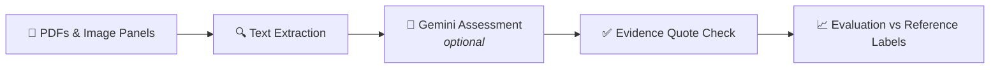

<div align="center">

# 🔬 Fractiva Claim Verification

**A command-line research prototype for checking pharmaceutical marketing claims against the research papers and source material supplied with the GoNuts.ai take-home assignment.**


</div>

---

The pipeline extracts text from PDFs and image panels, optionally asks Gemini to assess each claim, checks that returned evidence quotations match the cited source page, and compares predictions with the supplied reference labels.

> ⚠️ **Disclaimer:** This is not a medical advice tool or a substitute for expert review.

## 📑 Table of Contents

- [🎯 What It Does](#-what-it-does)
- [🧰 Requirements](#-requirements)
- [🪟 Setup on Windows](#-setup-on-windows)
- [📴 Run Offline](#-run-offline)
- [🤖 Optional Gemini Verification](#-optional-gemini-verification)
- [📦 Outputs](#-outputs)
- [🧪 Run Tests](#-run-tests)
- [🗂️ Project Layout](#️-project-layout)
- [📊 Current Run Status and Known Limitations](#-current-run-status-and-known-limitations)
- [🛡️ Responsible Use](#️-responsible-use)

---

## 🎯 What It Does

For each claim, the pipeline aims to assess:

- 🔢 Whether the numbers and figure match the cited source.
- 🧬 Whether the population, medicine, endpoint, comparison, and time point match.
- ⚖️ Whether the claim is supported, overstated, or cannot be verified from the available material.
- 📝 Whether the quoted evidence appears verbatim on the cited source page.

### 🔄 Pipeline



### 🏷️ Verdicts

| Verdict | Meaning |
| --- | --- |
| ✅ `supported` | Available evidence matches the claim on the assessed dimensions. |
| 🟠 `overstated` | Available evidence conflicts with or is weaker than an important part of the claim. |
| ❓ `cannot_verify` | Sources or model output are missing, invalid, incomplete, or insufficient. |

> 💡 `cannot_verify` is a safe failure state. API errors, quota errors, invalid model responses, and missing sources must not be interpreted as scientific findings.

---

## 🧰 Requirements

- 💻 Windows, macOS, or Linux.
- 🐍 Python 3.10 or newer.
- 🖼️ Tesseract OCR for image-only pages such as the supplied LixiLan-L abstract panel. The Python packages are installed from `requirements.txt`. On Windows, the code also checks the standard `C:\Program Files\Tesseract-OCR\tesseract.exe` path.
- 🔑 A Gemini API key is optional. Offline source extraction, evidence checks, evaluation, and unit tests do not require a key or network access.

---

## 🪟 Setup on Windows

Open PowerShell in the project folder and run:

```powershell
python -m venv .venv
.venv\Scripts\Activate.ps1
python -m pip install -r requirements.txt
```

If PowerShell blocks virtual-environment activation, run the commands below with the environment's Python executable directly, for example `.venv\Scripts\python.exe verify.py data/claims.json`.

### 🔧 Install Tesseract

Install Tesseract if it is not already installed:

```powershell
winget install --id UB-Mannheim.TesseractOCR --exact
```

Restart the terminal after installing Tesseract. Confirm it is available with:

```powershell
tesseract --version
```

When Tesseract is not on `PATH`, the verifier tries the standard Windows installation path.

---

## 📴 Run Offline

The default mode makes no Gemini requests. From the project folder:

```powershell
.venv\Scripts\Activate.ps1
python verify.py data/claims.json
python check_evidence.py
python eval.py
```

Or run without activating the environment:

```powershell
.venv\Scripts\python.exe verify.py data/claims.json
.venv\Scripts\python.exe check_evidence.py
.venv\Scripts\python.exe eval.py
```

Offline predictions are tagged `api_not_requested` (or another relevant source status) and use `cannot_verify` when the pipeline has not produced a verdict. This is expected: the offline run checks setup and local extraction, but it does not complete model-based scientific assessment.

> 🚫 Do not interpret its accuracy as model performance.

---

## 🤖 Optional Gemini Verification

1. 📋 Copy `.env.example` to `.env`.
2. 🔑 Add your key to `GEMINI_API_KEY` and set `GEMINI_ENABLED=true` in `.env`.
3. ▶️ Run the verification command once:

   ```powershell
   python verify.py data/claims.json
   ```

4. 🔎 Then inspect the output with:

   ```powershell
   python check_evidence.py
   python eval.py
   ```

The default model is `gemini-2.5-flash`; change `GEMINI_MODEL` in `.env` if needed. The verifier makes no automatic retries. Live requests can use API quota; a 429/quota error produces `cannot_verify` with an API failure status. Resolve quota or billing limits before trying another live run. A valid API key does not guarantee quota or a usable response.

> 🔒 **Security:** Never commit or share `.env`, API keys, or screenshots containing keys. `.env` and the detailed API log are excluded by `.gitignore`. Keep `.env.example` blank except for variable names and safe defaults.

---

## 📦 Outputs

| File / Script | Description |
| --- | --- |
| 📄 `outputs/predictions.json` | Latest prediction for each claim. Every `verify.py` run overwrites this file, including offline runs. |
| 🗒️ `outputs/llm_log.jsonl` | Local record of live requests, prompts, responses, and errors. It may contain claim and source text, is excluded from Git, and should be handled as research data. |
| 🔍 `check_evidence.py` | Reports `PASS`, `CHECK`, or `SKIP` for evidence file/page/quotation fidelity. A `PASS` only means the quote matches the cited source; it does not prove that the claim is scientifically correct. |
| 📈 `eval.py` | Compares current predictions to `data/gold.json` and prints accuracy, per-class metrics, confusion matrix, and warnings for invalid or incomplete runs. If outputs contain offline placeholders or API failures, the reported accuracy is not a valid model evaluation. |

---

## 🧪 Run Tests

```powershell
python -m unittest discover -s tests -v
```

The offline unit suite contains 11 tests and does not call Gemini.

---

## 🗂️ Project Layout

```text
.
├── data/
│   ├── claims.json          # Assignment claims and cited source names
│   └── gold.json            # Supplied reference labels for evaluation
├── papers/                  # Supplied study PDFs, abstract panel, promo material
├── outputs/
│   └── predictions.json     # Latest run (overwritten on each run)
├── tests/                   # Offline unit tests
├── verify.py                # Extraction and optional Gemini verification
├── check_evidence.py        # Quote/source/page checks
├── eval.py                  # Comparison against gold labels
├── inspect_weights.py       # Weight-panel inspection helper
├── requirements.txt
└── WRITEUP.md               # Assignment approach, findings, and limitations
```

---

## 📊 Current Run Status and Known Limitations

The following describes the latest checked state of this repository; new runs may change `outputs/predictions.json`.

- ✅ The local pipeline and its 11 offline unit tests passed in this environment.
- ❓ **C1:** Cites SOLIQUA prescribing information, but that label was not included in the supplied files. `papers/sanofi_Promo_Material.pdf` is promotional material and does not replace the prescribing information. C1 therefore remains `cannot_verify` until the cited label is supplied.
- ⛔ **C2–C7:** The latest Gemini run exhausted API quota. These claims currently have no live scientific verdict; their `cannot_verify` records report the run failure, not whether the claims are true or false.
- ⚠️ **C4 and C5:** An earlier run returned completed outputs for C4 and C5 and their quotations matched source text. C5's `supported` verdict conflicts with the assignment's supplied gold label (`overstated`) and needs human review. Quotation matching alone cannot settle that disagreement.
- 🚧 **C2/C3/C6 and C7:** Evidence/model-output validation for C2/C3/C6 and the combined C7 panel assessment still need successful review. Evaluation is incomplete; do not present the latest offline/API-failure accuracy as model performance or as completed scientific verification.

---

## 🛡️ Responsible Use

This prototype is for an assignment and research workflow. It does not replace a qualified review of study design, population, endpoints, statistical analysis, or current prescribing information. Preserve uncertainty when a source is unavailable or a check fails; do not convert a technical failure into a supported or overstated verdict.
